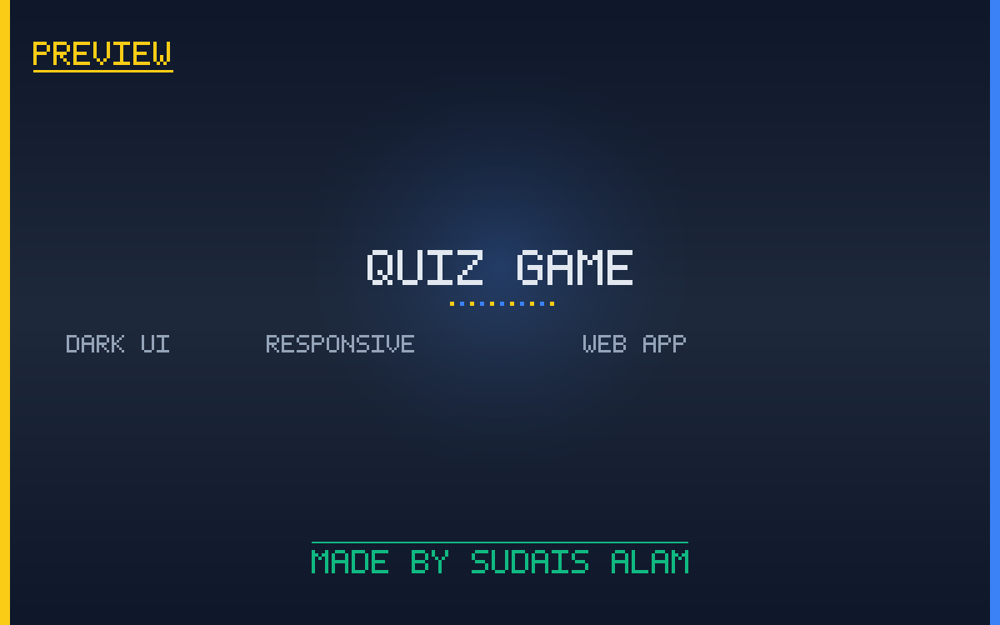

# Quiz Game

**Trivia Master** — a single-file quiz game web app powered by the **Open Trivia DB API**. Pick a category, difficulty, and question count, then race the timer through thousands of real trivia questions. High scores, streaks, and total quizzes played are saved in your browser.



---

## Features

- **Live trivia questions** from the [Open Trivia DB](https://opentdb.com) API — thousands of questions across many categories.
- **Customizable quiz setup**
  - Category (or *Any Category*)
  - Difficulty (Easy / Medium / Hard / Any)
  - Number of questions (5 / 10 / 15 / 20)
  - Per-question timer (or no timer)
- **Live scoring & progress** — current score, question progress (e.g. *Question 3 of 10*), and a countdown timer.
- **Streak tracking** — consecutive correct answers build your streak.
- **Persistent stats** — total quizzes played, high score, and streak are stored in `localStorage` and shown on the dashboard.
- **Leaderboard view** — dedicated leaderboard page.
- **Animated gradient UI** with floating shapes, Poppins typography, and Font Awesome icons.
- **Skip / Next** question controls.
- **Fully self-contained** — one HTML file, no build step.

---

## Tech Stack

| Layer        | Technology |
|--------------|------------|
| Markup       | Single `quiz game.html` (HTML5) |
| Styling      | Custom CSS, CSS variables, gradients, keyframe animations |
| Fonts/Icons  | Google Fonts (Poppins), Font Awesome 6 |
| Data         | Open Trivia DB REST API (`https://opentdb.com/api.php`) |
| Persistence  | Browser `localStorage` |
| Dependencies | All via CDN — no install required |

---

## How to Play

1. Open `quiz game.html` in a modern browser.
2. On the home page, view your stats (total quizzes, high score, streak).
3. Click **Start Quiz** (or go to the quiz page).
4. Choose a **Category**, **Difficulty**, **Number of Questions**, and **Timer**.
5. Answer each question before the timer runs out.
6. Correct answers increase your score and streak; wrong ones reset the streak.
7. At the end, your final score is compared against your saved high score.
8. Check the **Leaderboard** page to review performance.

> An internet connection is required the first time you play (to fetch categories/questions from Open Trivia DB).

---

## Project Structure

```
Quiz-game-/
├── quiz game.html          # Entire app (markup + CSS + JS)
├── README.md
├── SETUP.md
└── preview/preview.png
```

---

## Documentation

- [SETUP.md](SETUP.md) — how to run, host, and customize the quiz game.

---

## Credits

Powered by the [Open Trivia DB](https://opentdb.com) API.

Made by **Sudais Alam**.
